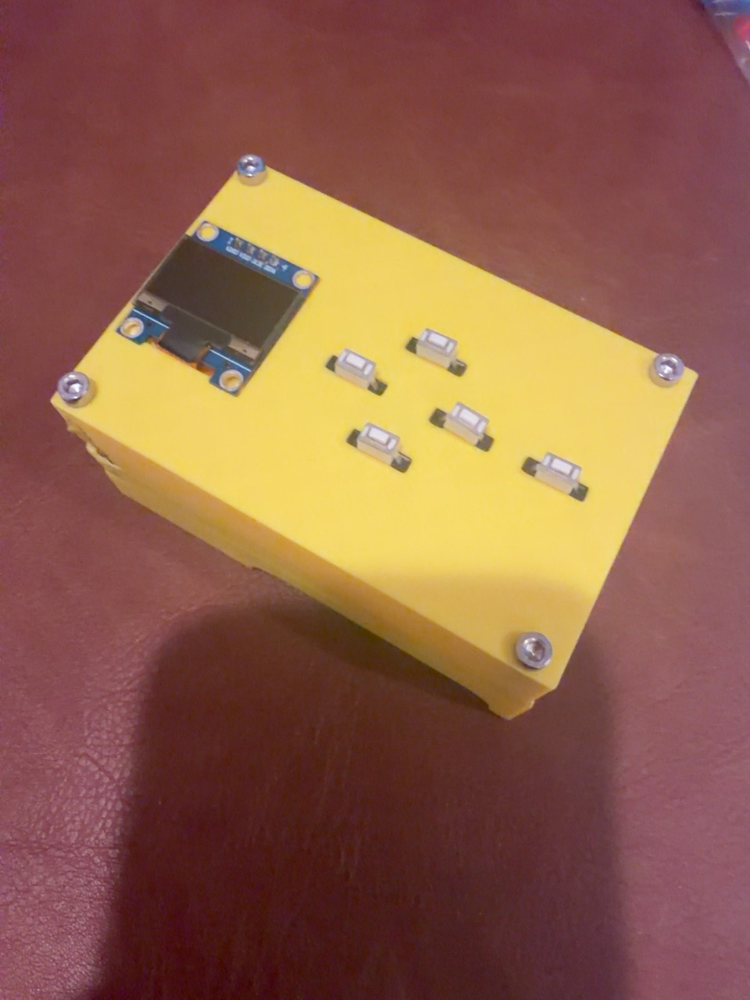

[English](README.md) · [简体中文](docs/README.zh-CN.md) · [Español](docs/README.es.md)

# Make Your MCU Ideas Real

**Bring an idea. Make something you can use.**

Describe the product you want. AI owns design and technical progress using tools it can actually access; you do necessary physical actions and confirm the result. It chooses one practical plan using existing hardware and software first. New parts favor easy assembly, such as pre-soldered modules and ready connectors, balanced against function, reliability and cost. You need not take a course or manage code; you can also choose to write it. A clear goal skips unrelated intake, and experience does not set an artificial complexity ceiling.

While parts ship, AI prepares code, builds, draft wiring, flash settings and useful checks. Draft wiring stays provisional until the real variant, pins and power are checked. AI then gives short physical steps with expected results, reads available logs directly and owns debugging to the agreed behavior. It keeps a compact project note for resuming and checks affected files and evidence when parts or functions change. Missing tools or agents leave only the dependent work pending. Payment, local prompts, plugging or soldering may still need you; the design aims to reduce that work.

## Choose an entry

| Skill | What it does |
| --- | --- |
| [MCU Builder](skills/build-with-ai-mcu/SKILL.md) — `$build-with-ai-mcu` | AI manages the technical work from idea to product. |
| [Code collaboration](skills/develop-with-ai-mcu/SKILL.md) — `$develop-with-ai-mcu` | Start or continue a project; choose who writes the code. |
| [Background checks](skills/test-mcu-in-background/SKILL.md) — `$test-mcu-in-background` | Reuse installed software and cached runtimes for focused checks. |
| [Firmware flashing](skills/flash-mcu-firmware/SKILL.md) — `$flash-mcu-firmware` | Preview and perform authorized uploads with existing tools. |
| [Product selection](skills/select-products-to-cart/SKILL.md) — `$select-products-to-cart` | Compare verified variants and top up a cart; never order. |
| [Optional PCB design](skills/design-pcb-with-ai/SKILL.md) — `$design-pcb-with-ai` | Design/check a requested PCB in existing usable EDA software. |

All six folders install independently. The existing five call names and repository path remain compatible. Optional companion Skills are never forced installations. Copy complete selected folders from `skills/` into your tool's supported Skill directory; for Codex use `$CODEX_HOME/skills`, or `~/.codex/skills` if unset. Check existing copies before replacing them and refresh discovery as needed. Available tools vary by platform.

```sh
git clone https://github.com/boyan-xu/build-with-ai-mcu.git
```

```text
Use $build-with-ai-mcu. Make a reminder that sounds when my door stays open
for more than 30 seconds. I have an ESP32 and Arduino IDE. Handle the code.
```

```text
Use $develop-with-ai-mcu. Continue my STM32 project and add PWM control.
I want to write the code. Inspect the timer setup and guide the next step.
```

## Parts first, with words you can copy

The default is a complete plain numbered list. Each item gives exact model/specification, purpose, required/owned/missing quantities and estimated missing cost with source/date, or an explicit unknown. A separate copyable search phrase includes critical specs and pack quantity. Include cables, power and necessary consumables. An unknown shopping platform or region never delays the list; verified links may supplement the words. Legacy interactive panels remain optional only on request.

After the COMPLETE list, AI offers cart help once. If accepted, it asks the platform only if unknown and explains cart only: no checkout, order, payment or subscription. Prior list/site opt-in is reused; links-only requests and refusals keep their scope. Selection first gates hard specs, compatibility, stock, delivery, seller and explicit budget, then ranks by evidenced preferred-spec matches before price. Missing evidence earns no preference match. Optional scalar-map `preferred_specs` uses candidate `specs` plus per-field `spec_evidence`; omitting it keeps the old total/arrival/official-seller order. Exact variant, pack arithmetic and a fresh cart readback remain required. [Selection contract](skills/select-products-to-cart/references/workflow.md).

## Main chat for the product, children for technical work

When agents are available, one persistent capable firmware child handles source, builds, tests and debugging. A separate PCB child is used only for a PCB request. At most two children run concurrently, with one writer per scope. The main AI owns product choices and authorization, receiving short outcomes, checks/evidence paths, limits and next action. In user-written-code mode it does not silently rewrite source. Without agents it continues bounded work and states capability limits. No delegation grants hardware, shopping, installation or publishing permission.

Both product entries carry the identical standalone standard-library `scripts/mcu_project.py`; no sibling imports or new registry. AI maintains optional project data, never asks users to fill JSON forms. Python 3.10+ is required. Reuse installed tools and current caches; explain necessary downloads first.

| Helper command | Result |
| --- | --- |
| `status` | Read-only resume view: current version/hashes, supplied notes, tracked Git changes and historical report references. |
| `validate` / `export --for test\|flash\|shopping` | Stage checks and compatible existing runner inputs; shopping subtracts owned physical stock. |
| `parts` | Numbered exact parts/search text and one-offer/site-reuse state. |
| `wiring` | Matching SVG, per-wire text and pin bindings from one explicit connection list. |
| `acceptance` / `diagnostics` | Honest behavior status/evidence and bounded summaries of allowlisted local reports. |
| `package` | Allowlisted hashed ZIP marked draft/unverified. |
| `package --reproducible` | Final artifact contract with required categories, input/build/version checks and extracted start guide. |

[Project tool contract](skills/build-with-ai-mcu/references/project-tools.md) · [Final replication contract](skills/build-with-ai-mcu/references/replication.md) · [Fictional draft example](skills/build-with-ai-mcu/assets/project-example/mcu-project.json).

Resume from short `status` or existing project notes, then read relevant source/callers and evidence as needed. Routine test/flash calls can use optional `--summary`: current status, process counts, known hashes, error excerpt and exact full report/log paths, with full saved evidence and original default output/exit codes preserved. Expand on failures, stale evidence or missing detail; an excerpt is not a diagnosis, and old reports never become fresh passes. Changed files guide navigation without excluding unchanged callers or hardware references. Status uses existing optional data only, writes nothing and scans no arbitrary notes. Its bounded Git view omits untracked files; missing Git/context remains unavailable. Keep private outputs local.

Reuse the persistent capable coding child with brief goals, acceptance, paths and current rights; return outcomes, evidence paths and open decisions. Select a light model only for suitable standard tasks when one is actually available. Reuse existing tool fingerprints/runtime checks instead of new setup; re-probe changed paths, versions or failed imports, while still verifying actual parts, supply, target and authority for each action. No new platform, registry, installation or context-mode dependency is required. These changes reduce repeated output/reads; real token savings and model quality are unmeasured. Flash preview's original output is already short, so summary may add bytes while adding evidence.

## PCB when requested

The main AI prepares `pcb-brief.json` from checked exact parts, nets/pins, supply, footprint sources, outline dimensions/shape/units, connectors, holes, keepouts and fabrication constraints. It asks only blocking facts. The persistent PCB child does actual schematic, placement and routing in your existing usable EDA software, separately from firmware work; without agents, the main AI does the work. No usable software connection means an honest brief/draft fallback, never a finished PCB claim or forced install.

Checks cover schematic/ERC, actual part-to-footprint pad/polarity mapping, layout/routing/DRC and virtual part/3D assembly clearance, orientation, dimensions and connector access. Missing models remain unknown. Circuit simulation is selective when useful models exist. Keep each proof type separate; there is no zero-error guarantee.

Deliver editable EDA sources, schematic, PCB, BOM, nets and check reports/limits. Fabricator outputs include Gerber/drill and needed assembly data; DIY outputs are process-specific 1:1 copper/outline/drill guides. No generic G-code without exact machine/tool/process setup. Reopen final manufacturing files and bind them to the revision. Critical unknown parts, nets, power, footprints or fabrication facts mean draft. PCB is electronic design; automatic mechanical CAD and direct printing remain outside this release. [PCB workflow](skills/design-pcb-with-ai/references/workflow.md).

## Keep a package someone else can build

Final handoff is a selected-project replication package: wiring image AND per-wire pins; exact BOM/specs/counts/search text; complete buildable application source/config/libraries/assets; matching compiled firmware when needed; exact tool/environment versions and build/flash steps; power/assembly/use/acceptance instructions; generated PCB/mechanical/print files if used; licenses/third-party credits; evidence/version checksums and known limits. Include every project-specific input, without private paths, missing includes/assets, hidden AI fixes or a further AI session to finish the design.

Tools or dependencies that cannot legally be bundled need exact versions, official acquisition/setup instructions and visible external prerequisites. `START-HERE.md` lists them after extraction; do not silently claim zero-download/offline completeness. Credentials belong to each replication user's local provisioning. `--reproducible` checks files, categories, quoted includes and a successful version/input/firmware/toolchain-bound build witness without executing code. AI still reviews the actual clean build and full dependency inventory: the helper cannot prove arbitrary transitive dependency completeness or report truth from labels. Basic packages remain draft/unverified.

The goal is the same specified design, configuration and behavior with exact parts and the supplied steps, without further coding/redesign. Artifact completeness is distinct from real-hardware proof. Physical tolerances and untested behavior cannot be guaranteed identical. Resolve critical power/pin/design facts before final status; unresolved blockers stay explicit.

## Checks and physical operation

Choose checks for the actual project, change and risk; every project need not run every test or simulator. Prefer existing background/headless tools, and browser previews when wanted. Report build, host logic, MCU simulation, electrical review, flash/readback and physical outcome separately. Keep actual evidence tied to the tested version. A host test or browser mock is not MCU simulation; neither proves electrical safety.

Verify exact models, pin labels, supply, polarity, current and drivers before wiring/power. Inspect the wiring image and match all pins with firmware. Disconnect power before wiring changes; movement needs limits and stop behavior. Build-only never authorizes flashing. Reuse clear same-target flash authorization during ordinary debugging, preserving existing work and checking target/current firmware/debugger. Downloads, installation and publication retain their own scope. Private records and secrets stay private; local ZIP creation does not publish it.

## Real example and historical evidence

[STMGames V1](showcases/stm-games-v1/README.md) is a real STM32 OLED game device made through many discussions and revisions. The maker designed its enclosure and did physical work; GPT-6.1 Sol completed the application code with third-party credits preserved. [Source archive](showcases/stm-games-v1/firmware-source.zip), [wiring image](showcases/stm-games-v1/wiring.svg), [original 3MF](showcases/stm-games-v1/OLEDGames.3mf). Power/electrical facts remain unresolved: this showcase is **not fully reproducible**, and this release did not operate it or rerun all games.



The [UNO low-voltage example](skills/build-with-ai-mcu/references/uno-led/README.md) and [fictional shopping browser record](skills/select-products-to-cart/references/fixture-verification.json) are historical evidence for their recorded sources/scenarios. Later source edits do not imply a new browser or MCU run. REA analysis remains [optional](skills/build-with-ai-mcu/references/rea.md); existing hardware/software comes first.

## Check the source and license

Run `python -B -m unittest discover -s tests -p "*_test.py"` and `node --test tests/*.test.mjs`. Tests use local fictional targets/vendor processes, not real hardware/shopping accounts. Validate each Skill with the skill-creator validator. [MIT license](LICENSE) covers original code/Skills; third-party files keep their own terms. Each user chooses whether to publish their project.

For instruction changes, also walk through realistic next actions: a one-sentence idea; clear needs with owned hardware; parts shipping; no agents or a missing tool; a next-day resume; a replacement part; a physical fault; and a final package with an essential fact missing. Check useful progress, honest evidence and the right stopping point. Preserve own-code mode, optional REA/publication and cart/flash rights. File checks alone do not prove this behavior.
