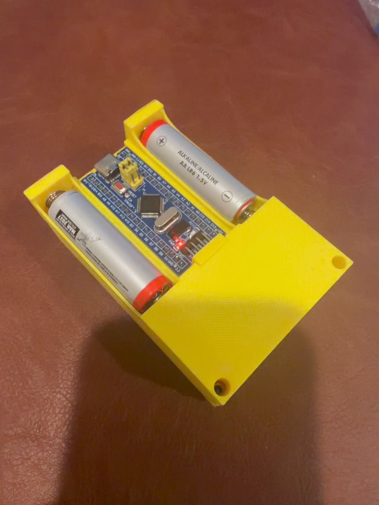

[English](README.md) · [简体中文](docs/README.zh-CN.md) · [Español](docs/README.es.md)

# Make Your MCU Ideas Real

**Bring an idea. Make something you can use.**

Make Your MCU Ideas Real helps turn your ideas into practical MCU products. Describe what you want it to do; AI works out the requirements and handles design, parts, firmware, simulation, setup and debugging with the tools it can actually use. You do not need to learn MCU programming or manage the code to begin.

Start with the hardware and software you already have. Get a checkable materials list with optional buying links for your region, a clear wiring image and short steps for the physical work. AI chooses useful checks for the current project, usually running them in the background, and reviews the electrical design before guiding physical operation.

A reminder, a controller, a sensor device: your desired behavior sets the direction. The path follows your idea and actual feasibility rather than an imposed experience tier. Work toward a usable result in clear milestones, with the files and instructions to keep using and improving it.

## Built with AI: STMGames V1

A real STM32 OLED game device, made through **many rounds of discussion, building and revision**. The maker designed the 3D enclosure and did the physical work; **GPT-6.1 Sol completed the application code**, with third-party credits preserved. This was not a one-prompt build or automatic CAD output.

| Front | Inside |
| --- | --- |
|  |  |

The collection includes Snake, Tetris, Space Invaders, Dino, 2048, Minesweeper, Breakout, Tower Defense, Stack and Timberman, plus nine standalone game projects. [Read the case and parts list](showcases/stm-games-v1/README.md), [download all firmware source](showcases/stm-games-v1/firmware-source.zip), see [the wiring image](showcases/stm-games-v1/wiring.svg) and [connection table](showcases/stm-games-v1/README.md#wiring-and-power-status), or get [the maker's original 3MF model and slicer project](showcases/stm-games-v1/OLEDGames.3mf). Photos show the real build; power details remain partly unverified, and this release did not rerun all games or operate hardware.

## Choose how to work

| Entry | What it does | Who writes code |
| --- | --- | --- |
| [Make Your MCU Ideas Real](skills/build-with-ai-mcu/SKILL.md) | AI handles the technical path from idea to product | AI by default |
| [Develop with AI MCU](skills/develop-with-ai-mcu/SKILL.md) | Collaborate on a new product or continue an existing project | You or AI; change the choice when needed |
| [Background MCU checks](skills/test-mcu-in-background/SKILL.md) | Reuse bundled scripts and a cached runtime to test code | AI prepares and runs focused checks |
| [Firmware flashing](skills/flash-mcu-firmware/SKILL.md) | Reuse installed flashing tools through a bundled runner | AI checks the target and handles authorized uploads |
| [Choose products and fill a cart](skills/select-products-to-cart/SKILL.md) | Compare verified products on your chosen website and add missing quantities | AI researches and adds to cart; never orders |

All five entries work independently. The two product entries adapt to your experience and preferred way of working. A clear request skips unrelated intake; no level test determines what you are allowed to create. Existing calls remain compatible. The three tool entries provide reusable background checks, flashing and product selection without forcing companion installations.

## From idea to product

1. **Make the goal clear.** Discuss what it should do and how to check success. Relevant memory can include tools, experience, chat preferences, learning style and small habits. Your current request takes priority; no budget or style questionnaire is required.
2. **Use what fits.** Check existing code, settings, interfaces and hardware first. For new parts, prefer suitable MCU/module combinations with documented simulation support. A workable existing board is not replaced merely for convenience.
3. **See what to get.** Use the parts panel for specifications, quantities, available materials, missing items and estimated extra cost. Regional buying links are examples; equivalent sellers and parts are welcome.
4. **Let AI implement and verify.** AI writes, compiles and fixes firmware using available tools, choosing tests or simulation when useful. Choose your own coding role in the collaborative entry if wanted. You do not have to complete a course or manage code changes.
5. **Connect and try it.** Receive a checked wiring image and matching text. The order of unpowered wiring and board flashing follows the setup. Get one short action, expected result and feedback point at a time; existing authorization is reused for the same target.
6. **Keep your product.** Receive source, wiring, any test or simulation files/results produced, a short use guide and known limits. You decide whether your own project stays private or becomes open source.

Conversation follows your pace without repeated probing or drifting away from the goal. Once the next step is clear, start doing it. A useful result within days is a goal when scope, tools and parts allow it, not a promise for every idea; product difficulty is assessed from real constraints rather than a fixed beginner catalog.

## Checks, previews and first operation

Not every project needs tests or simulation. AI chooses checks that resolve a real uncertainty or risk, using existing background/headless tools by default. If you want to see the effect before flashing, ask for a browser preview or rendered frames. The workflow adapts to your current need; it is not a fixed sequence.

Keep evidence for checks actually run, tied to the tested code and connections. A compile, a host unit test or a browser mock is not MCU simulation. ARM instruction execution with mocked peripherals covers exercised code paths, not the complete board or electrical behavior. Recheck affected behavior when relevant changes require it.

Simulation cannot prove zero bugs or that hardware cannot be damaged. Separately check actual supply, polarity, logic levels, current, resistors/drivers and load limits. Report build, logic tests, MCU simulation, electrical review, flash/readback and physical behavior separately.

Already own a board or module without a suitable simulation model? Keep it when it fits the goal. AI explains relevant coverage gaps and continues safe useful work with available tools. With authorization for the exact target, isolated-board flashing/diagnostics can proceed after target and electrical checks. That powers the board; it does not prove the complete connected product or justify full-load operation. See [the verification rules](skills/build-with-ai-mcu/references/verification.md).

## Install and start

Download with **Code → Download ZIP** or clone:

```sh
git clone https://github.com/boyan-xu/build-with-ai-mcu.git
```

Copy any complete Skill folders you need from `skills/` into your tool's supported skills directory. The product entries are `build-with-ai-mcu` and `develop-with-ai-mcu`; the tool entries are `test-mcu-in-background`, `flash-mcu-firmware` and `select-products-to-cart`. For Codex, use `$CODEX_HOME/skills` when set, otherwise `~/.codex/skills`. Check an existing same-name skill before replacing it; refresh discovery or start a new session if needed. Each entry carries its own resources and one instruction set for all three languages. Available tools vary by platform.

`select-products-to-cart` is also independently installable. After the parts list, AI offers once to choose missing items and add them to a cart on your selected site. You can keep asking for links only. The panel's separate cart button sends that explicit request; it never contacts a store itself.

```text
Use $build-with-ai-mcu. Make a reminder that sounds when my door stays open
for more than 30 seconds. Handle the technical work; I have an ESP32
and Arduino IDE already. Help me get a working result.
```

```text
Use $develop-with-ai-mcu. Continue my working STM32 project and add PWM control.
I want to write the code. Inspect the existing timer setup and help me
choose the next small implementation step.
```

No idea yet? Ask for five suitable possibilities. Already have parts or a partly working product? Start there. A milestone should lead toward your own goal, not replace it with an unrelated exercise.

## Included tools and evidence

- **Product selection without ordering:** [the shopping Skill](skills/select-products-to-cart/SKILL.md) combines browser evidence with a [standard-library comparison script](skills/select-products-to-cart/references/workflow.md). AI checks exact variants, pack quantities, delivery and listed price plus shipping, then tops up only matching missing quantities in the current cart. It preserves unrelated goods and stops before checkout, orders, payment or subscriptions. Missing shipping/specification evidence is held for review; the choice is among compared candidates, not a claim of the cheapest price everywhere. Login and website support can limit automation. Development checks use a local fictional shop, not real shopping accounts.

- **Reusable executable tools:** the [background test runner](skills/test-mcu-in-background/references/workflow.md) reuses existing software commands or compiles and runs Cortex-M C checks, with optional OLED framebuffer images. The [flash runner](skills/flash-mcu-firmware/references/workflow.md) defaults to an offline preview and uses existing STM32, ESP or Arduino tools for authorized writes. AI prepares the small project config; users need not edit scripts or JSON. Python 3.10+ is required. ARM dependencies are prepared once in a private cache and reused; a compiler and compatible flash backend must already be available or be installed as an explained separate step. The runners do not emulate every peripheral or promise support for arbitrary boards without adaptation.

- [Parts panel](skills/build-with-ai-mcu/assets/parts-checklist.html) and [integration notes](skills/build-with-ai-mcu/references/checklist.md): check items and retain valid progress in supported chat panels or standalone HTML. Link requests use the host's AI action when available; otherwise selectable request text is shown. The page does not secretly contact shops or an AI.
- [Low-voltage example](skills/build-with-ai-mcu/references/uno-led/README.md): matching image, connection definition, firmware and simulator diagram, with a [real MCU simulation record](skills/build-with-ai-mcu/references/uno-led/simulation-result.json) bound to the tested files. Its startup and digital-output checks passed in Wokwi; no physical device or electrical safety was tested. It is evidence of these scenarios, not a required first product.
- [Optional REA workflow](skills/build-with-ai-mcu/references/rea.md): when reproducing a product function, reuse an applicable existing [REA](https://github.com/morluto/rea) connection; only offer setup if needed and missing. Declining it does not stop ordinary work. Clarify rights before commercialization/public release; tool access does not grant rights to proprietary code or assets.

## Mechanical scope and practical limits

This release does not normally deliver automatic CAD, print-ready mechanical design or direct printing. For an enclosure, prefer ready-made cases/structures or a user-supplied model. Existing CAD skills, printers or CNC machines remain context. A future automatic CAD/print stage requires an explicit skill update; it is not enabled by a model's own confidence.

AI needs working tool connections to build, debug, simulate or access hardware. Necessary downloads, accounts and costs are explained first. Browser flashing needs compatible hardware and local access; universal zero-install support is not promised. Private credentials, memory and project records stay out of public files. This is a product workflow, not a fixed MCU course.

## Check the source

Run `node --test tests/*.test.mjs` for panel, package, connection and simulation-record consistency checks. Skill format can be checked with the official [skill-creator validator](https://github.com/openai/skills/tree/main/skills/.system/skill-creator). Unit checks are separate from the recorded MCU run and do not replace physical tests.

Run `python -B -m unittest discover -s tests -p "*_test.py"` for runtime reuse, runner failures, offline flash adapters and OLED export checks. The adapter tests use fake vendor processes, not connected hardware; the separate real ARM sample evidence is linked in the background runner workflow.

## License

[MIT](LICENSE). You may use, share and change these skills and their original runner code. Downloaded dependencies retain their own licenses. Each person chooses their own product's publication and license.
