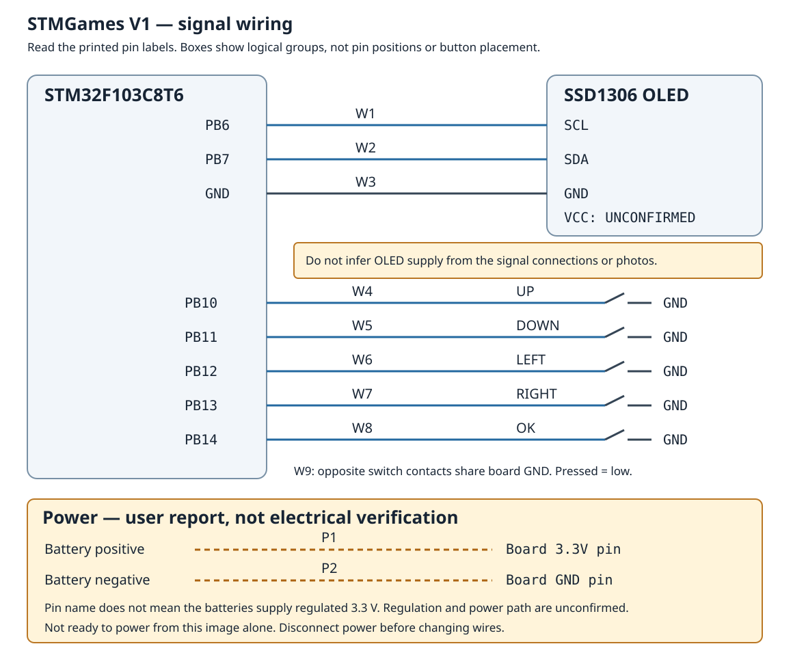

[English](README.md) · [简体中文](README.zh-CN.md) · [Español](README.es.md)

# STMGames V1: una consola OLED real

Un STM32F103C8T6, una pequeña pantalla OLED y cinco botones se convirtieron en una consola portátil con carcasa amarilla impresa. El proyecto pasó por **muchas rondas de conversación, montaje y revisión**; no se terminó con una sola petición ni en un solo intento. Su creador aportó las ideas, el trabajo físico y **todo el modelado 3D**. Según su testimonio, **GPT-6.1 Sol realizó todo el código de aplicación**. Las bibliotecas y los recursos de terceros conservan sus créditos y licencias.

| Frente | Interior |
| --- | --- |
|  |  |

Las fotos del dispositivo real fueron facilitadas por su creador. Muestran el aspecto y el montaje, sin demostrar que todos los juegos funcionen. Las copias publicadas no tienen metadatos; los originales permanecen intactos. Es un ejemplo histórico de colaboración entre una persona y la IA, no una prueba de que esta habilidad generase automáticamente toda la consola o su carcasa.

## Archivos disponibles

- [Código fuente completo del firmware](firmware-source.zip): una colección de diez juegos y nueve proyectos independientes para STM32CubeIDE, con código, controladores, arranque, ajustes del entorno y archivos de enlace y configuración. Importa las carpetas extraídas con tus herramientas existentes. No incluye resultados de compilación; pueden ser necesarios ajustes de versión. Esta exportación no se recompiló ni se cargó en la placa.
- [Diagrama de conexiones](wiring.svg), [datos de conexión](connections.json) y la tabla correspondiente más abajo.
- [OLEDGames.3mf original](OLEDGames.3mf): modelo y proyecto de laminado del creador, no un proyecto CAD nativo ni instrucciones G-code universales. Ábrelo en un laminador compatible, comprueba dimensiones, orientación, material y ajustes, y genera las instrucciones para tu impresora. Esta publicación no incluye nuevo modelado ni impresión física.
- [Inventario y sumas SHA-256](export-manifest.json). El ZIP contiene también `SOURCE_MANIFEST.sha256` para cada archivo exportado.

La colección incluye **Snake, Tetris, Space Invaders, Dino, 2048, Minesweeper, Breakout, Tower Defense, Stack y Timberman**. Hay nueve proyectos independientes, uno por juego salvo Tower Defense, que está en la colección. Se incluyen los 1.102 archivos de firmware necesarios para las configuraciones exportadas, unos 40,7 MB sin comprimir. Se excluyen registros privados de IA, archivos históricos, cachés y copias duplicadas. La carpeta V1 original no cambia.

## Materiales de este montaje

| Pieza | Cantidad | Notas |
| --- | --- | --- |
| Placa STM32F103C8T6 | 1 | Comprueba el modelo exacto y las etiquetas de pines |
| OLED I2C SSD1306 de 0,96 pulgadas | 1 | Confirma la alimentación del módulo concreto |
| Pulsador momentáneo de 3 × 6 mm | 5 | Arriba, abajo, izquierda, derecha y confirmar |
| Pilas AA | 2 | Tensión real y circuito de alimentación pendientes de verificar |
| Carcasa impresa diseñada por el creador | 1 conjunto | Modelo disponible arriba; tornillos, cables y contactos de pilas sin tamaños ni cantidades confirmados |

## Conexiones y alimentación

Es un diagrama lógico, no una vista de la posición física de los pines. Sigue las etiquetas de la placa y del módulo OLED. El firmware confirma I2C y cinco entradas con resistencias internas de subida. La conexión de los pulsadores a masa se deriva de esa configuración; no se midieron continuidad ni tensión en esta exportación.

| ID | Desde | Hasta | Evidencia |
| --- | --- | --- | --- |
| W1 | PB6 | OLED SCL | Reloj I2C1 del firmware |
| W2 | PB7 | OLED SDA | Datos I2C1 del firmware |
| W3 | GND de placa | OLED GND | Masa común necesaria |
| W4 | PB10 | Primer contacto de arriba | Entrada del firmware |
| W5 | PB11 | Primer contacto de abajo | Entrada del firmware |
| W6 | PB12 | Primer contacto de izquierda | Entrada del firmware |
| W7 | PB13 | Primer contacto de derecha | Entrada del firmware |
| W8 | PB14 | Primer contacto de confirmar | Entrada del firmware |
| W9 | GND de placa | Otro contacto de cada pulsador | Resistencia interna de subida; pulsado = nivel bajo |
| P1 | Positivo de pilas | Pin **3.3V de placa** | Conexión indicada por el creador |
| P2 | Negativo de pilas | Pin **GND de placa** | Conexión indicada por el creador |
| Pendiente | OLED VCC | Fuente sin confirmar por separado | No se deduce de las fotos |

El creador indicó los mismos pines **3.3V y GND usados al cargar el programa**. Son nombres de pines, no prueba de que dos pilas AA entreguen 3,3 V regulados. Siguen sin verificarse la tensión real, interruptores o reguladores, OLED VCC y la relación entre fuentes. Es un registro del montaje, no un diseño eléctrico completamente validado: comprueba estos detalles antes de reproducirlo o alimentarlo y desconecta la energía antes de cambiar cables. OLED VCC queda sin conectar en el dibujo para no adivinar.

## Créditos y límites de verificación

La licencia MIT del repositorio cubre el material original del caso y las contribuciones de aplicación, respetando los avisos de terceros. El archivo conserva las licencias ST HAL/CMSIS y `THIRD_PARTY_NOTICES.txt` de la colección y del proyecto Dino, incluida la atribución de imágenes de Chromium. La autoría de código por IA no sustituye esos derechos.

Esta publicación comprueba integridad, coherencia de pines y código, enlaces y metadatos de fotos. No recompila todos los juegos, repite pruebas históricas, simula el dispositivo completo, verifica alimentación, carga firmware en hardware ni imprime la carcasa. Fotos, testimonio del creador y comprobaciones nuevas se identifican por separado.
