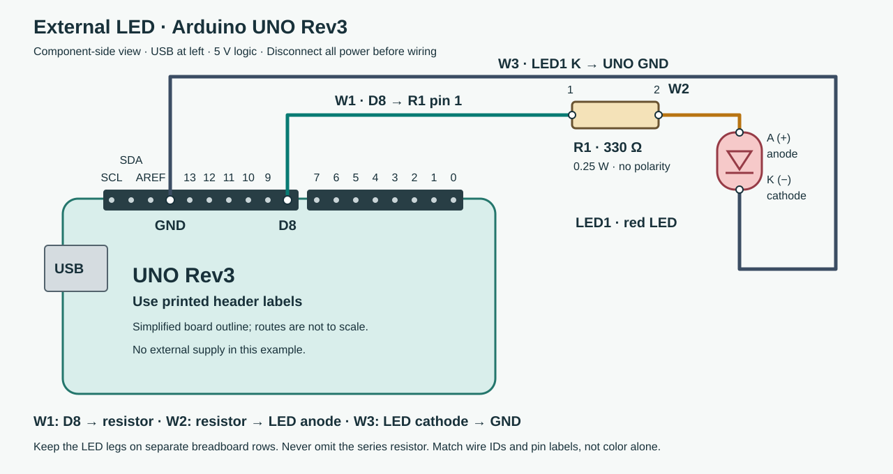

# Low-voltage wiring example

This is a reference for delivering a clear image, text and matching firmware, not a required first project. It uses an Arduino UNO Rev3, one red through-hole LED and a 330-ohm, 0.25 W series resistor. The board's I/O logic is 5 V; an ESP32 or other board needs its own verified wiring and must not inherit this diagram.

## Connect with power disconnected

View the component side with the USB connector on the left. The image shows the digital header at the top; match the printed **8** and **GND** labels on the real board. Unused pins are shown only for orientation. Wire positions are schematic routes, not breadboard-hole locations.

| Wire | From | To |
| --- | --- | --- |
| W1 | UNO D8 | R1 pin 1 |
| W2 | R1 pin 2 | LED1 A |
| W3 | LED1 K | UNO GND |

1. Disconnect USB and all other power before making or changing connections.
2. Connect W1 from digital pin 8 to one end of the resistor. The resistor has no polarity.
3. Connect W2 from the other resistor end to the LED anode, marked A or usually the longer leg. Check the LED's own markings/datasheet if legs have been cut.
4. Connect W3 from the LED cathode, marked K or usually the shorter leg/flat body side, to the digital header's GND pin. Put the LED legs on separate isolated breadboard rows.
5. Check the three paths before reconnecting USB power. Do not connect the LED directly between a GPIO and ground without its resistor.

Only the necessary ideas: the resistor limits current, LED polarity decides which way it conducts, and GND completes the path. There is no separate external supply in this example.

## Evidence and source

[connections.json](connections.json) is the connection definition. [uno-led.ino](uno-led.ino) uses digital pin 8; the automated checks compare it with the diagram and table. Expected behavior after a suitable build/flash is half a second on, half a second off. This repository does not claim an actual board was flashed, the sketch compiled for UNO or a physical LED tested.

Board pin labels, orientation and I/O facts were checked against the official [UNO Rev3 pinout](https://content.arduino.cc/assets/Pinout-UNOrev3_latest.pdf) and [UNO Rev3 documentation](https://docs.arduino.cc/hardware/uno-rev3/). The SVG is an original simplified drawing, not a reproduction of the vendor illustration. For a real learner, localize labels and verify the exact hardware before giving a wiring image.
